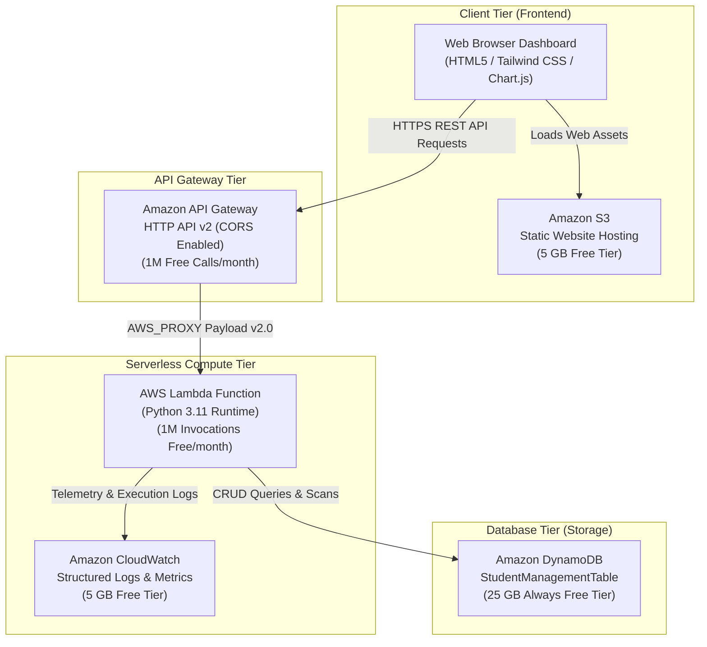
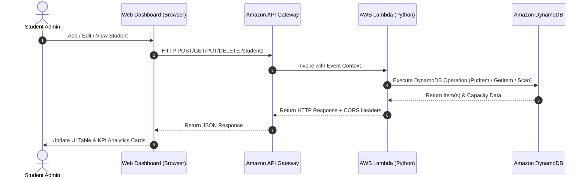

# 🏗️ AWS Serverless Architecture: Student Management System

## Overview
This system is architected as an **enterprise-grade, 100% AWS Free Tier-compliant Serverless application**. It eliminates idle server costs by leveraging event-driven services that only consume resources when requests are actively processed.

---

## Architecture Diagram



---

## Request Flow Sequence



---

## AWS Free Tier Cost Guarantee Analysis

| Service | AWS Free Tier Monthly Allowance | Project Usage | Estimated Cost |
| :--- | :--- | :--- | :--- |
| **AWS Lambda** | **1,000,000 requests** & 3.2M sec compute time | ~1,000 requests during development & evaluation | **$0.00** |
| **Amazon DynamoDB** | **25 GB** storage & 25 WCU / 25 RCU (**Always Free**) | < 1 MB storage, On-Demand / Free tier | **$0.00** |
| **Amazon API Gateway** | **1,000,000 HTTP API calls** / month | ~1,000 requests | **$0.00** |
| **Amazon S3** | **5 GB** standard storage, 20,000 GET requests | < 2 MB frontend assets | **$0.00** |
| **Amazon CloudWatch** | **5 GB** log ingestion & 10 custom metrics | < 5 MB application logs | **$0.00** |
| **Total Monthly Cost** | — | — | **$0.00 / month** |

> [!NOTE]
> Unlike traditional architectures using EC2 virtual machines or RDS MySQL databases that charge hourly even when unused, this serverless architecture costs **$0.00 when idle**. If no one queries your application, no compute runs.

---

## DynamoDB Data Model

### Primary Key Schema
* **Partition Key (HASH)**: `student_id` (String, e.g., `STU-1001`)

### Item Attributes
```json
{
  "student_id": "STU-1001",
  "first_name": "Aarav",
  "last_name": "Sharma",
  "email": "aarav.sharma@university.edu",
  "phone": "+1-555-0101",
  "department": "Computer Science",
  "year": "3rd Year",
  "gpa": 3.88,
  "status": "Active",
  "enrollment_date": "2022-08-15",
  "courses": [
    "Cloud Computing",
    "Data Structures",
    "Operating Systems"
  ],
  "created_at": "2024-01-15T08:30:00Z",
  "updated_at": "2024-01-15T08:30:00Z"
}
```

---

## Security & IAM Principle of Least Privilege

The Lambda execution role (`StudentManagementLambdaRole`) is locked down to strictly necessary actions:
```json
{
  "Version": "2012-10-17",
  "Statement": [
    {
      "Effect": "Allow",
      "Action": [
        "dynamodb:GetItem",
        "dynamodb:PutItem",
        "dynamodb:UpdateItem",
        "dynamodb:DeleteItem",
        "dynamodb:Scan",
        "dynamodb:Query"
      ],
      "Resource": "arn:aws:dynamodb:*:*:table/StudentManagementTable*"
    }
  ]
}
```
